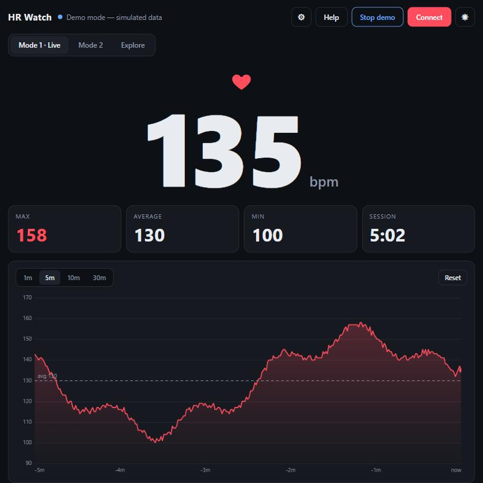

<div align="center">

# ❤️ HR Watch

**Live heart rate from your Polar H10 (or any Bluetooth heart rate strap), right in your browser.**

[**▶ Try it live**](https://YOUR-USERNAME.github.io/YOUR-REPO/)




</div>

## Why

You already own the sensor, so you shouldn't need a vendor app or an account to read your own heartbeat, and your health data shouldn't be sent back to its maker.

HR Watch is **free and open source**. It runs **entirely in your browser**: no install, no account, no server. Your data is **never sent anywhere**. The current session is saved only in your browser so it survives a reload (you can turn this off), and it leaves your device only if you export it yourself.

## Features

- **Live** — big BPM readout, max / average / min, session timer, chart of the last 1–30 minutes
- **Heart rate zones** — the 5 standard training zones from your age or your own max heart rate, shown as columns with a cursor moving through the current zone, plus time spent in each zone
- **Explore** — zoom and drag through a whole session, with stats for the visible part and an overview strip
- **Export / import** — save sessions as JSON (re-importable) or CSV (spreadsheets), all as local files
- **Reliable** — reconnects automatically if the signal drops, and a page reload doesn't lose your session
- **Settings** — light and dark mode, max heart rate formula or override, CSV separator for Excel, screen-awake and more, remembered in your browser
- **Demo mode** — try everything without a strap

> **About the zones:** max heart rate is estimated from your age (10–100) with `220 − age` or `208 − 0.7 × age`. These formulas are averages from studies of adults and can be off by 10+ bpm, and they don't suit young children. If you know your real max heart rate, enter it as an override in Settings (100–240 bpm) and the age is ignored.

## Browser support

| Browser | Works? |
|---|---|
| Chrome, Edge (Windows, Mac, Android) | ✅ Out of the box |
| Brave | ⚙️ Enable `brave://flags/#brave-web-bluetooth-api` |
| Firefox, Safari | ❌ No Web Bluetooth |
| iPhone / iPad | ⚙️ Use the free [Bluefy](https://apps.apple.com/app/id1492822055) browser |

The in-app **Help** button has step-by-step instructions for each one.

## Run it yourself

No build step and no dependencies, just static files. Clone the repo, then serve the folder locally (Web Bluetooth needs `localhost` or `https`):

```sh
python -m http.server 8000
```

Open <http://localhost:8000>, press **Connect** and pick your strap. Any static host works too, e.g. GitHub Pages.

## License

[GNU GPL v3](LICENSE). Free to use, study, change and share.
