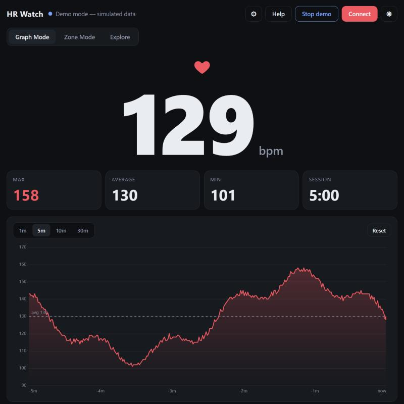
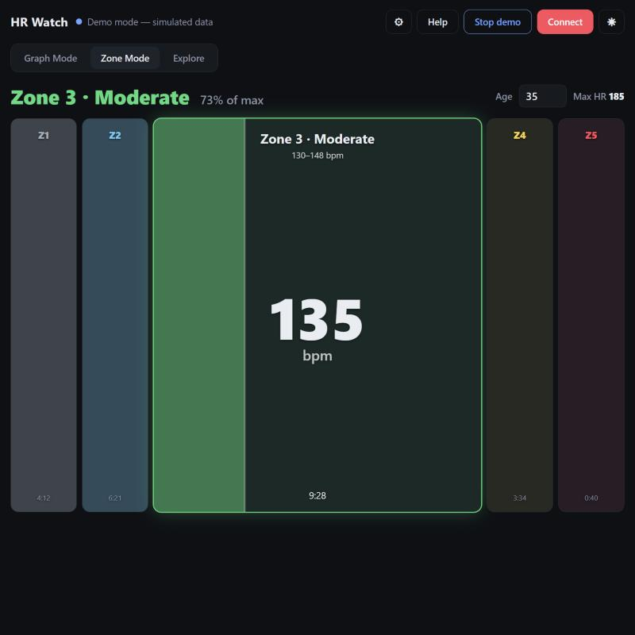
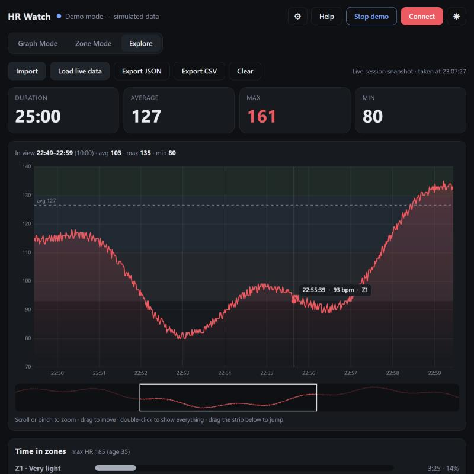

<div align="center">


# HR Watch

**Live heart rate from your Polar H10 (or any Bluetooth heart rate strap), right in your browser.**<br>
Free, open source and private: no app, no account, no server.

[**▶ Try it live**](https://lcucurachi.github.io/hr-watch/) &nbsp;·&nbsp; [Features](#features) &nbsp;·&nbsp; [Get started](#get-started) &nbsp;·&nbsp; [Privacy](#privacy)


</div>

<table>
  <tr>
    <td align="center" width="33%">
      <br>
      <b>Graph Mode</b><br><sub>Live BPM, stats and chart</sub>
    </td>
    <td align="center" width="33%">
      <br>
      <b>Zone Mode</b><br><sub>Training zones at a glance</sub>
    </td>
    <td align="center" width="33%">
      <br>
      <b>Explore</b><br><sub>Zoom through a whole session</sub>
    </td>
  </tr>
</table>

## Why HR Watch?

You already own the sensor. You shouldn't need a vendor app or an account to read your own heartbeat, and your health data shouldn't be sent back to its maker.

| | |
|---|---|
| 🔒 **Private** | Runs entirely in your browser. Your data is never sent anywhere. |
| 🆓 **Free & open source** | GPL v3. No ads, no subscription, no sign-up. |
| ⚡ **Nothing to install** | Open the page and connect, or install it as an app if you prefer. |
| 📴 **Works offline** | Once installed, it opens without an internet connection. |

## Features

- 📈 **Graph Mode** — big BPM readout, max / average / min, session timer, chart of the last 1–30 minutes
- 🎯 **Zone Mode** — the 5 standard training zones from your age or your own max heart rate, shown as columns with a cursor moving through the current zone, plus time spent in each zone
- 🔍 **Explore** — zoom and drag through a whole session, with stats for the visible part and an overview strip
- 💾 **Export / import** — save sessions as JSON (re-importable) or CSV (spreadsheets), as local files
- 🔄 **Reliable** — reconnects automatically if the signal drops, and a page reload doesn't lose your session
- ⚙️ **Settings** — light and dark mode, max heart rate formula or override, CSV separator for Excel, screen-awake and more, remembered in your browser
- 📱 **Installable** — its own icon, a full-screen window, and it opens offline
- 🎧 **Background recording** *(experimental, off by default)* — keeps recording when you switch to another app on your phone
- 🧪 **Demo mode** — try everything without a strap

> [!NOTE]
> **About the zones:** max heart rate is estimated from your age (10–100) with `220 − age` or `208 − 0.7 × age`. These formulas are averages from studies of adults and can be off by 10+ bpm, and they don't suit young children. If you know your real max heart rate, enter it as an override in **⚙ Settings** (100–240 bpm) and the age is ignored.

> [!IMPORTANT]
> **Background recording is experimental.** Phones normally pause a web page soon after you switch to another app, which stops the readings. To prevent that, HR Watch can play an **inaudible 15 Hz tone** while recording (below human hearing and below what phone speakers can reproduce). It is **off by default**: turn it on in **⚙ Settings → Experimental**. While active it shows a **♪ keep-alive** badge, and your phone may show it as media playing; if it gets paused, the badge turns into **♪ paused, tap to resume**. It works on Android Chrome and on iPhone in Safari with the WebBLE extension; other browsers are untested. It uses a bit more battery.

## Get started

1. Wet the strap's electrodes and put it on.
2. Open **[HR Watch](https://YOUR-USERNAME.github.io/YOUR-REPO/)** in a [supported browser](#browser-support).
3. Press **Connect** and pick your strap.

No strap at hand? Press **Demo** to try it with simulated data.

## Browser support

| Browser | Works? |
|---|---|
| Chrome, Edge (Windows, Mac, Android) | ✅ Out of the box |
| Brave | ⚙️ Enable `brave://flags/#brave-web-bluetooth-api` |
| Firefox, Safari (Mac) | ❌ No Web Bluetooth |
| iPhone / iPad | ⚙️ Safari with the [WebBLE](https://apps.apple.com/app/id6761301368) extension, or the free [Bluefy](https://apps.apple.com/app/id1492822055) browser |

The in-app **Help** button has step-by-step instructions for each one.

## Install as an app

- **Android, Windows, Mac (Chrome / Edge):** use **Install app** in the browser menu, or the install icon in the address bar.
- **iPhone / iPad:** Share → **Add to Home Screen**.

> [!WARNING]
> **On iPhone and iPad, Bluetooth most likely won't work in the Home Screen app**, because Safari extensions like WebBLE don't run there. Keep recording in Safari + WebBLE (or Bluefy); the installed app is still handy for **Explore**.

Installing changes nothing about privacy: it's the same page, still with no server and nothing sent anywhere.

## Privacy

- **No server, no account, no tracking.** HR Watch is just static files, so there is no backend that could receive your data.
- **Bluetooth stays local:** the strap talks directly to your device.
- **Saved only in your browser:** your settings, and the current session so a reload doesn't lose it (you can turn this off). **⚙ Settings → Delete saved data** removes both.
- **Exports are files you save yourself.** Nothing leaves your device unless you share those files.

## Development

<details>
<summary><b>Run it locally</b></summary>

<br>

No build step and no dependencies, just static files. Clone the repo, then serve the folder (Web Bluetooth needs `localhost` or `https`):

```sh
python -m http.server 8000
```

Open <http://localhost:8000>, press **Connect** and pick your strap. Any static host works too, e.g. GitHub Pages.

The offline/install support is switched off on `localhost` so your edits show up immediately; open <http://localhost:8000/?sw> to test it.

</details>

<details>
<summary><b>Project structure</b></summary>

<br>

| File | What it does |
|---|---|
| [`index.html`](index.html) | Page layout, Settings and Help panels, and `APP_VERSION` |
| [`style.css`](style.css) | Styles, light and dark themes |
| [`app.js`](app.js) | Bluetooth, live data, Graph and Zone Mode, settings, background keep-alive |
| [`explore.js`](explore.js) | Explore tab, import and export |
| [`storage.js`](storage.js) | Saves the live session in the browser (IndexedDB) |
| [`tooltip.js`](tooltip.js) / [`help.js`](help.js) | Delayed tooltips / Help panel |
| [`sw.js`](sw.js) | Offline support for the installed app |
| [`manifest.webmanifest`](manifest.webmanifest), [`icons/`](icons) | App name and icons for installing |
| [`docs/`](docs) | Screenshots for this README |

Everything the app stores uses the `hrwatch` prefix (`hrwatch.*` settings, the `hrwatch` database, `hrwatch-<version>` offline files), so it doesn't clash with other projects hosted on the same GitHub Pages site.

</details>

<details>
<summary><b>Releasing</b></summary>

<br>

Change `APP_VERSION` at the top of [`index.html`](index.html) to match the new tag, then commit and tag as usual. The version is shown in ⚙ Settings and added to the CSS/JS links, so browsers download fresh files instead of mixing old cached ones with a new release. The installed app's offline copy updates from the same number.

</details>

## License

[GNU GPL v3](LICENSE). Free to use, study, change and share.
